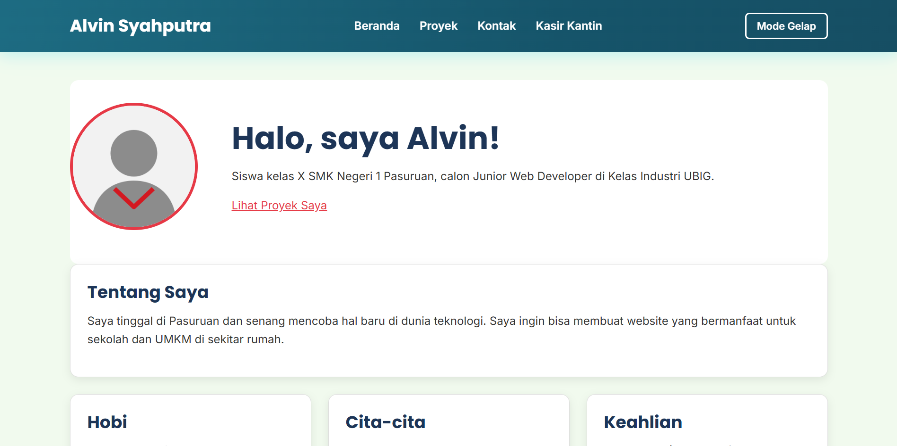

# Portofolio Alvin Syahputra

Website portofolio pribadi yang saya buat di Kelas Industri UBIG (Paket 1, Minggu 01 sampai 09).

Website ini menampilkan profil, keahlian, proyek, dan informasi kontak saya. Website dirancang responsif agar nyaman digunakan melalui ponsel, tablet, maupun laptop.

---

## Tampilan

---

## Fitur

- Halaman **Beranda** berisi profil, hobi, cita-cita, keahlian, dan jadwal belajar.
- Halaman **Proyek** berisi daftar proyek dalam bentuk kartu.
- Filter proyek berdasarkan kategori HTML, CSS, dan JavaScript.
- Halaman **Kontak** berisi formulir untuk menghubungi saya.
- Penghitung karakter pada formulir kontak.
- Mode terang dan mode gelap.
- Integrasi GitHub API untuk menampilkan daftar repositori.
- Tampilan responsif menggunakan Flexbox dan Media Query.

---

## Teknologi

- HTML5
- CSS3 (Flexbox, Media Query, dan CSS Variables)
- JavaScript
- JSON
- Git dan GitHub
- GitHub API

---

## Pengujian Lighthouse

Pengujian website dilakukan menggunakan Lighthouse untuk memeriksa:

- Performance
- Accessibility
- Best Practices
- SEO

---

## Hasil Pengujian Lighthouse

Pengujian dilakukan menggunakan Lighthouse pada tiga halaman website.

| Halaman | Performance | Accessibility | Best Practices | SEO |
|---|---:|---:|---:|---:|
| Beranda | 94 | 94 | 96 | 91 |
| Proyek | 60 | 93 | 96 | 91 |
| Kontak | 95 | 93 | 96 | 90 |

---

## Tautan

- **Website:** https://portofolio-alvin-gold.vercel.app/
- **GitHub:** https://github.com/alvinsyahputra2345-source/portofolio-alvin

---

**Dibuat oleh:** Alvin Syahputra  
**Sekolah:** SMK Negeri 1 Pasuruan  
**Program:** Kelas Industri UBIG – Paket 1